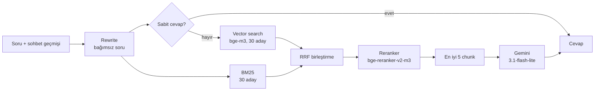

# campus-chatbot

**Bolu Abant İzzet Baysal Üniversitesi (BAİBÜ) mevzuatı üzerinden soru cevaplayan, kaynak gösteren bir RAG chatbot.**

Öğrenciler "Yatay geçiş başvurusu için not ortalamam kaç olmalı?", "Kaç dersten devamsızlık hakkım var?" ya da
"Bahar dönemi final sınavları ne zaman?" gibi sorular sorar. Chatbot cevabı üniversitenin yönetmelik, yönerge ve akademik
takvim belgelerinden bulur ve her bilginin yanında belgeyi ve madde numarasını verir
(ör. `[BAİBÜ Yatay Geçiş Yönergesi, Madde 8]`). Cevap belgelerde yoksa uydurmak yerine "Bu konuda bilgim yok." der.

Bu proje bir bitirme projesidir. Sistemdeki her tasarım kararı, ölçülmüş ve tekrar üretilebilir bir **deney** olarak
kayıtlıdır (bkz. [Deneyler](#deneyler)).

---

## Özellikler

- **Kaynaklı cevap:** Her cevapta belge adı ve madde numarası yer alır. Arayüzde atıfa tıklayınca yan panelde ilgili madde açılır; oradan PDF'in ilgili sayfasına gidilebilir.
- **Çekimser kalma:** Bağlamda cevap yoksa model tahmin yürütmez, "bilgim yok" der.
- **Takip soruları:** "Peki bunun son günü ne?" gibi sorular, sohbet geçmişine bakılarak bağımsız bir soruya dönüştürülür
  ve öyle aranır.
- **Kapsam farkındalığı:** Aynı konu farklı fakültelerde farklı düzenlenmişse (ör. Tıp Fakültesinin ayrı yönetmeliği)
  genel kuralı verir ve öğrencinin fakültesini sorar.
- **Web arayüzü:** sohbet ekranı, belge ve chunk tarayıcısı, cevapları etiketlemek için yönetici paneli.
- **REST API:** FastAPI ile; Swagger dokümantasyonu `/docs` adresinde.
- **Deney altyapısı:** retrieval ve cevap kalitesini ölçen değerlendirme koşucusu, istatistiksel testler
  (McNemar / Wilcoxon) ve otomatik üretilen deney günlüğü.

## Nasıl çalışır?



**1. Belgelerin hazırlanması (`ingest.py`).** PDF'ler `pdfplumber` ile okunur. Mevzuat **madde madde** chunk'lara bölünür:
her chunk tek bir maddedir; çok uzun maddeler fıkra sınırından ikiye ayrılır. Akademik takvimde her tablo bir chunk olur.
Sabit boyutlu bölme yerine yapısal bölmenin seçilme nedeni, bir maddenin yarısının bir chunk'ta yarısının ötekinde
kalmasını önlemektir. Chunk'lar `BAAI/bge-m3` ile embedding'e çevrilip FAISS index'ine yazılır. Index, kendisini etkileyen
parametrelerin (belge kümesi, chunking, embedding modeli...) **fingerprint**'iyle adlandırılır; belge başına cache
sayesinde yalnız değişen belgeler yeniden işlenir.

**2. Retrieval (`rag.py`).** Soru iki yoldan aranır:
- **Vector search** anlam benzerliğini yakalar ("okuldan ayrılmak" ↔ "kayıt sildirme").
- **BM25** kelime eşleşmesini yakalar (madde numaraları, "AKTS", "GNO" gibi terimler). Türkçe eklemeli bir dil olduğu
  için kelimelerin ilk 5 harfi alınarak basit bir kök bulma yapılır.

İki liste **Reciprocal Rank Fusion (RRF)** ile birleştirilir. İlk 30 aday bir **cross-encoder reranker**
(`BAAI/bge-reranker-v2-m3`) ile soruyla birlikte okunup yeniden sıralanır ve en iyi 5 chunk modele bağlam olarak verilir.

**3. Cevap üretimi.** Gemini, system prompt'taki kurallarla yalnız bağlamdaki bilgiyi kullanarak, kaynak göstererek cevap
yazar. Yürürlükten kalkmış konular (ör. yaz okulu) için retrieval yapılmadan sabit bir cevap döner. Bağlamda aynı konuyu
farklı fakülteler için düzenleyen belgeler varsa (belge kapsam etiketleri `data/belge_kapsam_v1.json`), netleştirme
prompt'u kullanılır: genel kural verilir ve öğrencinin fakültesi sorulur.

## Kurulum

Gereksinimler: Python 3.11, bir [Gemini API anahtarı](https://aistudio.google.com/apikey). Production yapılandırması
NVIDIA GPU (CUDA) kullanır; GPU yoksa aşağıdaki [CPU notu](#gpu-olmadan-çalıştırma)na bakın.

```bash
git clone https://github.com/ariftahab/campus-chatbot.git
cd campus-chatbot
python -m venv venv
venv\Scripts\activate                    # Windows  (Linux/macOS: source venv/bin/activate)

# GPU için torch'u önce CUDA build'iyle kurun, yoksa pip CPU sürümünü indirir:
pip install torch==2.9.0 --index-url https://download.pytorch.org/whl/cu128
pip install -r requirements.txt
```

Proje köküne bir `.env` dosyası oluşturun:

```
GOOGLE_API_KEY=...
# İsteğe bağlı: yönetici paneli (/admin). Tanımlı değilse panel kapalıdır.
ADMIN_USER=admin
ADMIN_PASSWORD=...
```

İlk çalıştırmada embedding ve reranker modelleri (~6.5 GB) Hugging Face'ten indirilir ve index kurulur (GPU'da birkaç
dakika). Sonraki açılışlar index'i diskten okur.

## Kullanım

### Web arayüzü ve API

```bash
python -m uvicorn app.main:app --port 8000
```

| Adres | İçerik |
|---|---|
| http://localhost:8000/ | Sohbet ekranı |
| http://localhost:8000/belgeler | Belgeler ve chunk'ları; atıflardan buraya gelinir |
| http://localhost:8000/admin | Yönetici paneli: kullanıcı sorularını ve cevapları görme, doğru/yanlış etiketleme |
| http://localhost:8000/docs | API dokümantasyonu (Swagger) |

Başlıca API uçları: `POST /ask` (soru sor), `POST /feedback` (cevabı beğen/beğenme), `GET /documents`,
`GET /documents/{source}/chunks`, `GET /files/{source}` (PDF), `GET /health`.

```bash
curl -X POST http://localhost:8000/ask -H "Content-Type: application/json" \
     -d '{"question": "Yatay geçiş başvurusu için not ortalaması kaç olmalı?", "history": []}'
```

Sohbet kayıtları `logs/` altına JSONL olarak yazılır ve repoya girmez (kullanıcı soruları kişisel veri sayılır).

### Terminal sohbeti

```bash
python chat.py          # 'yeni' geçmişi temizler, 'çık' ile çıkılır
```

### GPU olmadan çalıştırma

Hangi parametrelerle çalışılacağını `config.PRODUCTION_EXPERIMENT` belirler (şu an `EXP-038`). CPU'da çalıştırmak için
bu config'i kopyalayıp `device` değerini `"cpu"`, `reranker_dtype` değerini `"fp32"` yapın ve `PRODUCTION_EXPERIMENT`'i
yeni config'e çevirin. CPU'da retrieval saniyeler mertebesinde sürer.

## Proje yapısı

```
config.py            yollar, belge kümeleri (CORPORA), RagConfig (bütün RAG parametreleri), PRODUCTION_EXPERIMENT
ingest.py            PDF okuma, chunking, embedding, FAISS index + belge bazında cache
rag.py               Retriever (vector / BM25 / hybrid + reranker), prompt sürümleri, RagBot
chat.py              terminal sohbeti
app/                 FastAPI (api.py), iş mantığı ve log'lar (service.py), arayüz (static/)
data/                PDF'ler, belge kümesi listeleri (corpus_v*.txt), belge kapsam etiketleri
eval/                soru setleri (soru, beklenen kaynak madde, kanıt cümlesi, beklenen cevap)
experiments/         configs/ (deney tanımları), results/ (sonuçlar), run.py, evaluation.py, report.py,
                     experiment_log.md (otomatik üretilir)
```

## Deneyler

RAG hattındaki her değişiklik (PDF okuyucu, chunking, embedding, retrieval yöntemi, reranker, prompt, LLM) bir deney
olarak yapılır:

- Her deney `experiments/configs/EXP-XXX.json` dosyasında tanımlıdır ve üst deneyden **tek bir parametre** farklıdır.
- Neden, hipotez, birincil metrik ve beklenen yön deney koşulmadan önce yazılır.
- Sonuç dosyası, deneyin koşulduğu **commit hash**'ini kaydeder; böylece her sonuç tekrar üretilebilir.
- Aynı sorular üzerinde eşleştirilmiş testler (McNemar, Wilcoxon) ile değişimin anlamlı olup olmadığına bakılır.

**Değerlendirme.** Bir chunk, beklenen kaynak belgeye aitse ve o belgede birebir geçen kanıt cümlesini içeriyorsa ilgili
(relevant) sayılır. Retrieval için MRR@10, Hit@k ve bağlam isabeti; cevaplar için anlamca değerlendirilen cevap doğruluğu,
netleştirme isabeti ve atıf metrikleri ölçülür.

**Retrieval hattının kurulduğu ilk deneyler** (3 belge, 30 soruluk set 2.0):

| Değişiklik | MRR@10 | Hit@1 |
|---|---|---|
| Prototip: sabit boyutlu chunking, MiniLM, yalnız vector search | 0.564 | 0.444 |
| Yapısal (madde madde) chunking | 0.716 | 0.556 |
| Embedding: MiniLM → bge-m3 | 0.920 | 0.852 |
| Chunk boyutu 1000 → 1500 karakter | 0.938 | 0.889 |
| Hybrid retrieval (BM25 + RRF) | 0.938 | 0.889 |
| Reranker (bge-reranker-v2-m3) | **1.000** | **1.000** |

**Güncel sistem** (129 belge, 3753 chunk; 149 soruluk set 4.2: bulma, kapsam, çekimser kalma, takip ve birleştirme
soruları):

| MRR@10 | Hit@1 | Hit@5 | Cevap doğruluğu | Retrieval latency (GPU) |
|---|---|---|---|---|
| 0.830 | 0.748 | 0.953 | 0.953 | ~410 ms |

Belge sayısı 3'ten 129'a çıkınca görev zorlaştığı için iki tablo birbiriyle karşılaştırılmaz. Bütün deneyler, hipotezler
ve yorumlar: [`experiments/experiment_log.md`](experiments/experiment_log.md).

```bash
python -m experiments.run EXP-037          # retrieval metrikleri (API çağrısı yok)
python -m experiments.run EXP-037 --llm    # cevap kalitesini de ölç (Gemini kotası harcar, soru başına ~1 istek)
python -m experiments.report               # deney günlüğünü yeniden üret
```

**Yeni deney eklemek için:** bir config'i kopyalayıp yeni kimlik verin, `ust_deney` alanını karşılaştırılacak deney yapın
ve `params` içinde yalnız bir parametreyi değiştirin. `neden`, `hipotez`, `birincil_metrik` ve `beklenen_yon` alanlarını
doldurun, kodu commit'leyin, sonra deneyi koşun.

## Belgeler

`data/` klasöründeki PDF'ler üniversitenin kamuya açık mevzuatıdır (yönetmelikler, yönergeler, akademik takvim).
Hangi belgelerin index'e girdiğini belge kümesi belirler (`config.CORPORA`; güncel küme `data/corpus_v4.txt`).
Yeni bir belge eklemek için PDF'i `data/`'ya koyup yeni bir belge kümesi tanımlayın; index kendiliğinden yeniden kurulur.
Eski deneyler eski belge kümesiyle ölçüldüğü için yeni kümeyle yapılan ölçümlerle karşılaştırılamaz.

## Sınırlamalar

- Chatbot yalnız index'teki belgeleri bilir; duyurular, ders programları ve birim web sayfaları kapsam dışıdır.
- Belgeler güncellendiğinde cevaplar da ancak PDF'ler yenilenip index yeniden kurulunca güncellenir.
- Cevaplar resmî görüş değildir; kesin bilgi için ilgili birime başvurulmalıdır.

## Kullanılan teknolojiler

Python 3.11 · LangChain · FAISS · sentence-transformers (bge-m3, bge-reranker-v2-m3) · rank-bm25 · pdfplumber ·
Google Gemini · FastAPI · vanilla JavaScript
